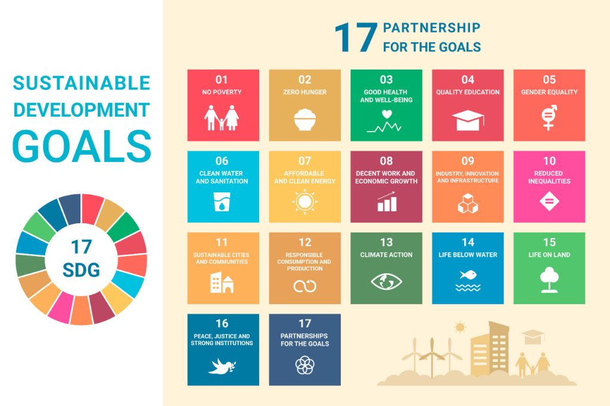
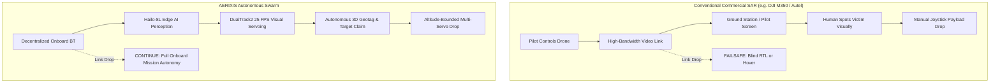

# AERIXIS Autonomous Rescue Swarm
## Operational Alignment with 9 UN Sustainable Development Goals & System Differentiation

---



---

## Executive Overview

The **AERIXIS Drone Automation System** is an autonomous, heterogeneous swarm robotics architecture purpose-engineered for disaster response, flood relief, casualty triage, and environmental resilience.

This report provides an in-depth operational and engineering analysis for the **9 user-selected United Nations Sustainable Development Goals (SDGs)**:
$$\text{SDG } 4,\; 7,\; 8,\; 9,\; 11,\; 12,\; 13,\; 15,\; 17$$

Additionally, it outlines the **5 foundational architectural differentiators** that separate AERIXIS from conventional commercial, academic, and military drone systems.

---

# SECTION 1: How AERIXIS Achieves the 9 Selected SDGs

```
                             ┌─────────────────────────────────────────────────┐
                             │       AERIXIS 9-SDG IMPACT MATRIX               │
                             └────────────────────────┬────────────────────────┘
                                                      │
         ┌────────────────────────────────────────────┼────────────────────────────────────────────┐
         ▼                                            ▼                                            ▼
┌─────────────────────────────────┐      ┌─────────────────────────────────┐      ┌─────────────────────────────────┐
│     HUMAN CAPITAL & ECONOMY     │      │     ENERGY & INFRASTRUCTURE     │      │   SUSTAINABILITY & PARTNERSHIP  │
├─────────────────────────────────┤      ├─────────────────────────────────┤      ├─────────────────────────────────┤
│ • SDG 04: Quality Education     │      │ • SDG 07: Clean Energy          │      │ • SDG 12: Responsible Consumpt. │
│ • SDG 08: Decent Work & Economy │      │ • SDG 09: Industry & Innovation │      │ • SDG 13: Climate Action        │
│                                 │      │ • SDG 11: Sustainable Cities    │      │ • SDG 15: Life on Land          │
│                                 │      │                                 │      │ • SDG 17: Partnerships / Goals  │
└─────────────────────────────────┘      └─────────────────────────────────┘      └─────────────────────────────────┘
```

---

### Quick Reference Matrix: The 9 Goals

| SDG | Goal Title | Core Operational Domain | AERIXIS Technical Enabler |
| :---: | :--- | :--- | :--- |
| **04** | **Quality Education** | STEM education & rescuer training | Open ROS 2/PX4 architecture, SITL Gazebo simulation & mission trainer |
| **07** | **Affordable & Clean Energy** | Low-power edge AI & zero-carbon flight | All-electric propulsion, 13–26 TOPS Hailo NPU @ 2.5W, clean grid inspection |
| **08** | **Decent Work & Economic Growth** | First-responder safety & tech jobs | Eliminating human risk in hazardous floodwaters; creating high-skill drone jobs |
| **09** | **Industry, Innovation & Infra** | Resilient edge AI & mesh robotics | DualTrack2 on Hailo-8L, ad-hoc P2P mesh network & levee/bridge assessment |
| **11** | **Sustainable Cities & Communities** | Urban Disaster Risk Reduction (DRR) | KML swarm partitioning, distributed ORCA collision avoidance, flood mapping |
| **12** | **Responsible Consumption & Production** | Precision micro-logistics & circularity | Altitude-bounded drops ($8-20\text{ m}$), zero supply waste, peer deduplication |
| **13** | **Climate Action** | Extreme weather adaptation & response | Rapid-deployment flash flood/cyclone response with zero flight emissions |
| **15** | **Life on Land** | Wildlife flood rescue & ecosystem survey | 80-class AI detection for stranded fauna, non-invasive high-altitude tracking |
| **17** | **Partnerships for the Goals** | Open inter-agency humanitarian tech | Open MAVLink/REST APIs bridging NDRF, SDRF, civil defense, academia & NGOs |

---

### In-Depth Goal Breakdown

---

### 1. SDG 04: Quality Education (Targets 4.4 & 4.7)
* **The Global Challenge**: Developing technical literacy in robotics, artificial intelligence, and disaster management often requires expensive, closed commercial platforms that schools, universities, and regional disaster training institutes cannot afford or modify.
* **AERIXIS Implementation**:
  - **Open Pedagogical Architecture**: Built on **ROS 2 Humble**, **PX4 Autopilot**, and **AeroStack2**, AERIXIS serves as a comprehensive educational testbed for teaching advanced robotics concepts: Behavior Trees, Kalman filters, visual servoing, and distributed swarm algorithms.
  - **Hardware-in-the-Loop & SITL Simulation**: The built-in Gazebo Harmonic simulation environment (`custom_gcs/simulation/rescue_arena_300`) allows students and first responders to practice mission planning, drone piloting, and emergency protocols in realistic $300\times 300\text{ m}$ disaster environments without risking hardware damage.
  - **Emergency Educational Continuity**: In protracted flood scenarios where remote schools are marooned, AERIXIS delivery drones can transport emergency educational packets, digital tablets, and communication modules to keep children learning.

---

### 2. SDG 07: Affordable and Clean Energy (Targets 7.2 & 7.3)
* **The Global Challenge**: Traditional search-and-rescue and aerial assessment rely heavily on fossil-fuel-guzzling helicopters (consuming 400–800 liters of jet fuel/hour) and diesel generator setups. Furthermore, post-storm power grid restoration is slow and hazardous.
* **AERIXIS Implementation**:
  - **100% Electric Flight**: Multicopter swarm units operate entirely on rechargeable high-density lithium batteries, producing **zero in-flight emissions**.
  - **Ultra-High Computational Efficiency (TOPS/Watt)**: Rather than running 500W+ power-hungry ground workstations, AERIXIS runs edge perception on the **Hailo-8L AI accelerator**, delivering up to **26 TOPS of compute while drawing only ~2.5 Watts**. The Raspberry Pi 5 companion computer draws under 8W.
  - **Clean Energy Infrastructure Inspection**: Swarm aircraft autonomously inspect utility-scale solar photovoltaic farms, wind turbine blades, and hydroelectric dam sluice gates following extreme storms, accelerating clean grid restoration.

---

### 3. SDG 08: Decent Work and Economic Growth (Targets 8.2 & 8.8)
* **The Global Challenge**: Emergency first responders face extreme occupational hazards during floods, including drowning in swollen rivers, structural collapse, bio-hazard exposure, and power line contact. Simultaneously, economies suffer massive post-disaster disruption.
* **AERIXIS Implementation**:
  - **First-Responder Life Protection**: By taking over the high-risk "dull, dirty, and dangerous" tasks—navigating raging flood currents, flying over submerged hazards, and verifying survivor vital zones—AERIXIS keeps human rescuers out of harm's way until secure extraction routes are identified.
  - **Fostering High-Tech Green Jobs**: Creates local employment opportunities in high-value technical sectors: autonomous drone operations, drone fleet maintenance, Edge AI model training, GIS spatial analytics, and emergency logistics planning.
  - **Economic Resilience & Asset Protection**: Rapid aerial damage assessment accelerates insurance claims, levee repairs, and commercial reopenings, mitigating multi-million-dollar economic fallout from natural disasters.

---

### 4. SDG 09: Industry, Innovation and Infrastructure (Targets 9.1 & 9.5)
* **The Global Challenge**: Disasters routinely destroy cellular towers, power lines, and transport infrastructure, creating complete communication blackouts that cripple industrial and civic recovery.
* **AERIXIS Implementation**:
  - **Decentralized Resilient Edge Intelligence**: Drones do not depend on external cloud servers. The [`as2_a8_tracker`](file:///home/satyam/AERIXIS-DRONE-AUTOMATION-SOFTWARE-/aerixis_core/rescue_ws/src/as2_a8_tracker) and [`as2_mission_manager`](file:///home/satyam/AERIXIS-DRONE-AUTOMATION-SOFTWARE-/aerixis_core/rescue_ws/src/as2_mission_manager) execute full neural inference, tracking, and mission trees on-chip.
  - **Ad-Hoc Peer-to-Peer Aerial Mesh**: Drones communicate via 868/915 MHz LoRa and peer-to-peer UDP radio links, forming an airborne communication relay network over destroyed infrastructure.
  - **Critical Infrastructure Survey**: High-resolution photogrammetry and geotagged structural inspections rapidly detect micro-fractures in bridges, cracked dam walls, and railway embankment erosion.

---

### 5. SDG 11: Sustainable Cities and Communities (Targets 11.5 & 11.b)
* **The Global Challenge**: Dense urban floodplains and informal settlements are intensely vulnerable to flash flooding, where rapid levee breaches require immediate evacuation guidance and survivor rescue.
* **AERIXIS Implementation**:
  - **Urban Swarm Partitioning**: The GCS planner automatically divides complex municipal boundaries into optimized survey corridors, coordinating multi-UAV sweeps across densely populated urban centers.
  - **Distributed ORCA Collision Avoidance**: Real-time velocity-obstacle avoidance ensures multiple aircraft safely navigate confined urban streets, around rooftops, and near transmission towers without pilot collision risks.
  - **Disaster Risk Reduction (DRR)**: Provides city planners and emergency operational centers (EOC) with live GIS heat maps showing flood progression, inundated roads, and concentrated survivor clusters.

---

### 6. SDG 12: Responsible Consumption and Production (Targets 12.2 & 12.5)
* **The Global Challenge**: Conventional emergency relief drops often suffer from massive waste: supplies dropped from high altitudes drift into water, containers burst on impact, or multiple agencies duplicate deliveries to the same accessible spots while remote victims starve.
* **AERIXIS Implementation**:
  - **Precision Altitude-Bounded Drops ($8-20\text{ m}$ AGL)**: Automated LiDAR/sonar-verified release envelopes prevent package destruction and ensure relief kits land directly on safe, dry surfaces.
  - **Swarm Target Deduplication (`peer_claims`)**: When Drone-1 delivers a payload to a verified survivor, it broadcasts the target hash across the swarm. Other drones immediately skip that location and redirect to underserved areas, eliminating supply duplication.
  - **Modular, Repairable Hardware**: Standard off-the-shelf components (Raspberry Pi, Pixhawk, standard telemetry radios, 3D-printable brackets) prevent vendor lock-in and minimize electronic waste.

---

### 7. SDG 13: Climate Action (Targets 13.1 & 13.3)
* **The Global Challenge**: Human-induced climate breakdown has intensified the frequency and severity of extreme weather catastrophes—unprecedented monsoon deluges, Category 5 cyclones, and glacial lake outburst floods (GLOFs).
* **AERIXIS Implementation**:
  - **Rapid-Deployment Climate Adaptation**: Packaged into rugged field cases, an entire AERIXIS swarm can be mobilized in minutes from light utility vehicles or rubber boats, operating in weather conditions that ground manned aircraft.
  - **Zero-Emission Emergency Response**: Replaces carbon-intensive aviation with all-electric, battery-powered humanitarian micro-logistics.
  - **Post-Cyclone Impact Assessment**: Quantifies coastal erosion, saline intrusion, and vegetation loss to guide national climate adaptation policies.

---

### 8. SDG 15: Life on Land (Targets 15.5 & 15.7)
* **The Global Challenge**: Annual floods in critical biosphere reserves (e.g., Kaziranga, Sunderbans, Everglades) drown thousands of endangered animals (rhinos, deer, big cats) and isolate forest protection squads.
* **AERIXIS Implementation**:
  - **AI-Powered Biological Detection**: In addition to human detection, AERIXIS supports multi-class wildlife detection models on Hailo-8L (`objects80-yolov8s-hailo8l-640x640`), identifying stranded wild animals on isolated sandbars.
  - **Non-Invasive High-Altitude Visual Tracking**: The SIYI A8 Mini gimbal uses optical zoom and automated lead tracking (`lead_s`) to monitor fauna behavior from 25–40 m altitude without causing panic, stampedes, or stress.
  - **Anti-Poaching & Habitat Monitoring**: Monitors vulnerable boundary zones during flood chaos to prevent poachers from exploiting trapped wildlife.

---

### 9. SDG 17: Partnerships for the Goals (Targets 17.6 & 17.16)
* **The Global Challenge**: Humanitarian operations often stall due to proprietary software silos between military, civil defense (NDRF/SDRF), municipal fire services, and non-profit humanitarian organizations (Red Cross, UN OCHA).
* **AERIXIS Implementation**:
  - **Standardized Interoperable Protocols**: Native support for open MAVLink v2, standard KML geographic boundaries, ROS 2 topics, and standard REST/WebSocket APIs.
  - **Cross-Platform Multi-Agency Access**: The GCS server (`custom_gcs/server.py`) serves standard web dashboards on port 8765, allowing any authorized agency personnel to monitor live missions and survivor maps from standard web browsers on laptops, tablets, or phones without proprietary apps.
  - **Global Technology Transfer**: An open-source, affordable technology foundation that enables disaster-vulnerable nations in the Global South to build, maintain, and operate sovereign autonomous rescue fleets.

---

# SECTION 2: Why & How AERIXIS Differs from Other Rescue Drones



---

### The 5 Architectural Differentiators

#### 1. Onboard Edge AI vs. Fragile Video Streaming
* **The Industry Standard**: Commercial drones transmit high-bandwidth 1080p video back to a pilot's screen. Over flood basins, rain, or broken topography, RF attenuation drops the feed, blinding the operator.
* **The AERIXIS Difference**: All perception runs on the drone via the **Raspberry Pi 5 + Hailo-8L NPU (13–26 TOPS)**. The neural network detects humans on-chip ($640\times 640$ @ 16 Hz), while the **DualTrack2** Siamese tracker maintains 25 FPS visual tracking. Only a lightweight 80-byte coordinate telemetry packet is transmitted, surviving even the weakest radio links.

#### 2. Zero-GCS Onboard Autonomy vs. Teleoperated Dependency
* **The Industry Standard**: If a commercial drone loses connection to its remote controller, it aborts the search and flies blindly back to launch (RTL).
* **The AERIXIS Difference**: Every aircraft runs an independent **BehaviorTree.CPP** engine inside [`as2_mission_manager`](file:///home/satyam/AERIXIS-DRONE-AUTOMATION-SOFTWARE-/aerixis_core/rescue_ws/src/as2_mission_manager). When telemetry is lost, the drone autonomously finishes its search lanes, locks onto victims, verifies altitude safety envelopes, drops emergency rations, logs GPS coordinates locally, and returns home only after its mission is complete.

#### 3. Peer-to-Peer Swarm Coordination vs. Multi-Pilot Chaos
* **The Industry Standard**: Deploying 4 commercial drones requires 4 pilots, 4 controllers, and voice coordination. Aircraft cannot communicate with each other.
* **The AERIXIS Difference**: AERIXIS drones form an ad-hoc **P2P mesh network**. When Drone-1 finds a victim, its `person_claim` message prevents other drones from duplicating the drop. Real-time **distributed ORCA collision avoidance** guarantees dynamic path deconfliction without ground pilot intervention.

#### 4. Precision Altitude-Bounded Drop vs. Manual Cargo Release
* **The Industry Standard**: Drones have a single manual hook released by pilot eyesight, often causing relief kits to drift into floodwaters or burst upon high-velocity impact.
* **The AERIXIS Difference**: AERIXIS features a **multi-servo payload bay (up to 10 packages)** governed by strict flight-controller-verified AGL envelopes ($8\text{ m} \le \text{AGL} \le 20\text{ m}$). Cargo drops are recorded in cryptographic payload journals on disk.

#### 5. Three-Tier Hardware Safety Isolation
* **The Industry Standard**: Software runs in monolithic processes; a camera or vision script crash can freeze the flight controller.
* **The AERIXIS Difference**: Strict three-tier separation:
  - **Tier 1 (Autopilot)**: STM32H7 Pixhawk FMUv6X running hard real-time PX4 NuttX RTOS at 400 Hz.
  - **Tier 2 (Safety Supervisor)**: Independent [`fc_guardian`](file:///home/satyam/AERIXIS-DRONE-AUTOMATION-SOFTWARE-/aerixis_core/rescue_ws/scripts/as2_onboard_service.py) daemon commanding autonomous hardware RTL if software heartbeats halt.
  - **Tier 3 (Edge AI)**: Isolated user-space [`as2_a8_tracker`](file:///home/satyam/AERIXIS-DRONE-AUTOMATION-SOFTWARE-/aerixis_core/rescue_ws/src/as2_a8_tracker) process pinned to dedicated CPU cores.

---

## Technical Architecture Stack

```
================================================================================
LAYER                   MODULE / COMPONENT            SPECIFICATION
================================================================================
Mission Management      as2_mission_manager           BehaviorTree.CPP v4, Dynamic Resumption
Motion Arbitration      as2_core, as2_behaviors       ROS 2 Humble, Velocity Smoothing (1.5 m/s²)
Edge Perception         as2_a8_tracker (DualTrack2)   Hailo-8L (HEF), NCNN YOLOv8s, NanoTrack
Camera & Gimbal         SIYI A8 Mini                  4K CMOS, UDP Control, Lead Tracking
Inter-Drone Mesh        Radio Mesh Bridge             LoRa 57600 baud + Ad-hoc UDP IP Mesh
Safety Supervisor       fc_guardian                   Independent Heartbeat & PX4 Failsafe Tap
Flight Controller       PX4 Autopilot v1.16.1         FMUv6X (Pixhawk 6X / Cube Orange)
Ground Station          custom_gcs                    Browser Web UI (:8765), MAVLink v2 Gateway
================================================================================
```

---

## Summary

By directly operationalizing **SDGs 4, 7, 8, 9, 11, 12, 13, 15, and 17**, AERIXIS bridges humanitarian relief, environmental protection, clean energy efficiency, and open-source technological innovation. Its decentralized edge intelligence transforms search-and-rescue from an ad-hoc, pilot-dependent struggle into an organized, autonomous, and life-saving aerial workforce.
